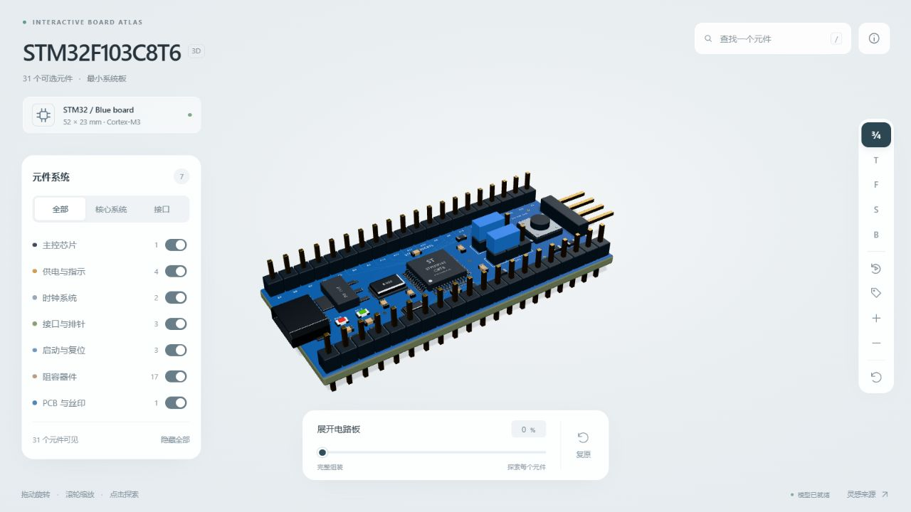

# STM32 Board Atlas

一个可在浏览器中探索的 **STM32F103C8T6 最小系统板**，基于 React、TypeScript、Three.js、React Three Fiber 与 Vite 构建。

支持旋转缩放、点击选中元件、搜索、系统显隐、单独查看、视角切换和爆炸展开。无需后端、数据库、API Key 或 Blender，即可运行与部署网页。



制作过程、工具分工、完整建模环境备份与新设备恢复步骤，见 [制作流程与迁移](docs/制作流程与迁移.md)。

## 功能

- **31 个可选元件 / 7 类系统**：主控、供电与指示、时钟、接口、启动与复位、阻容器件、PCB。
- **元件检查**：点击三维模型，或从搜索及分类中选择，查看说明与参数。
- **单独查看与聚焦**：隐藏其他元件，检查局部结构。
- **爆炸展开**：通过底部 0–100% 滑块分开各元件，随时恢复组装。
- **视角工具**：三分之四、俯视、正视、侧视、后视，自动旋转、缩放与标注。
- **响应式界面**：小屏通过“元件系统”按钮展开面板，尊重系统的减少动画设置。
- 模型、材质与环境光均在本地提供，不依赖外部字体、HDR 或模型服务。

> 本项目用于外观和布局展示，不提供电路仿真。走线、阻容器件和连接关系不作为 PCB 生产设计依据。

## 快速开始

准备 **Node.js 22.12+（22.x）**、npm 和支持 WebGL 的浏览器。若选择 Node.js 20，则需要 20.19+。

```bash
git clone https://github.com/yzfh-ty/stm32-board-atlas.git
cd stm32-board-atlas
npm ci
npm run dev
```

打开 [http://127.0.0.1:5173/](http://127.0.0.1:5173/)。

局域网访问时运行：

```bash
npm run dev -- --host 0.0.0.0
```

同一局域网设备使用运行电脑的实际 IP 与端口 5173 访问；默认仅监听本机。

### 常用命令

| 命令 | 用途 |
| --- | --- |
| `npm ci` | 按锁文件安装依赖 |
| `npm run dev` | 启动开发服务器，端口 5173 |
| `npm run check` | TypeScript 检查 |
| `npm run build` | 类型检查并构建，输出到 `dist/` |
| `npm run preview` | 本机预览构建结果，端口 4173 |

`npm run preview` 只用于本机检查，正式环境使用静态托管平台或 Nginx 等 HTTP 服务器。不要直接双击 `dist/index.html` 打开。

## 部署

本项目是纯静态网站，部署内容为 **整个 `dist/` 目录**，包括 `assets/` 和 `models/`。

Vite 已设置相对资源路径 `base: './'`，同时支持域名根目录与 GitHub Pages 的仓库子目录。模型地址同样使用构建时的 `BASE_URL`，不需要手动修改。

### Vercel

1. 在 Vercel 中导入 `yzfh-ty/stm32-board-atlas`。
2. 使用下表配置并部署。仓库内的 `vercel.json` 已声明主要构建设置。

| 设置 | 值 |
| --- | --- |
| Framework Preset | Vite |
| Root Directory | 仓库根目录 |
| Install Command | `npm ci` |
| Build Command | `npm run build` |
| Output Directory | `dist` |
| Node.js | 22.x |
| Environment Variables | 无需设置 |

后续推送到部署平台设置的生产分支即可触发更新。

### GitHub Pages

仓库已提供 `.github/workflows/deploy-pages.yml`。**首次需要在 GitHub 中启用 Pages，再手动运行工作流**；推送本身不会自动发布。

1. 打开仓库 **Settings → Pages → Build and deployment**。
2. 将 **Source** 设置为 **GitHub Actions**。
3. 打开 **Actions → Deploy GitHub Pages → Run workflow**，选择 `main`。
4. 等待工作流成功，访问其显示的部署地址。

保留默认域名时，预期地址为：

[https://yzfh-ty.github.io/stm32-board-atlas/](https://yzfh-ty.github.io/stm32-board-atlas/)

该地址只有启用 Pages 并部署成功后才可访问；创建仓库和推送源码不等于网站已上线。后续更新也可重新运行此工作流。

### Netlify / Cloudflare Pages

从 GitHub 导入仓库，设置：

- 生产分支：`main`
- 安装命令：`npm ci`
- 构建命令：`npm run build`
- 输出目录：`dist`
- Node.js：22.12+，推荐 22.x
- 环境变量：无需设置

框架预设可选择 Vite。平台若已自动安装依赖，不需要在构建命令中重复安装。

### 自有服务器 / Nginx

先在开发机或构建服务器执行：

```bash
npm ci
npm run build
```

将 `dist/` 的**全部内容**上传至站点目录，例如 `/var/www/stm32-board-atlas/`。下面是域名根目录部署的 Nginx 示例：

```nginx
server {
    listen 80;
    server_name board.example.com;

    root /var/www/stm32-board-atlas;
    index index.html;

    location / {
        try_files $uri $uri/ =404;
    }

    location /models/ {
        try_files $uri =404;
        default_type application/octet-stream;
    }
}
```

将示例域名和路径替换为自己的配置，通过 `nginx -t` 后重新加载。HTTPS 可交由现有反向代理处理。若部署在已有站点的子目录，保持生成后的相对目录结构即可。

## 操作说明

| 操作 | 效果 |
| --- | --- |
| 鼠标拖动 / 单指拖动 | 旋转模型 |
| 鼠标滚轮 / 双指缩放 | 缩放 |
| 点击模型上的元件 | 高亮并打开详情 |
| 左侧分类名称 | 展开元件列表 |
| 左侧开关 | 显示 / 隐藏对应系统 |
| 单独查看 / 显示整体 | 在局部和整板之间切换 |
| 底部滑块 | 爆炸展开或组装 |
| `/` | 搜索元件 |
| `1`–`5` | 切换预设视角 |
| `R` | 重置全部 |
| `Esc` | 关闭搜索、说明或详情 |

## 目录结构

```text
src/
  App.tsx                    界面、搜索、系统开关与交互状态
  BoardViewer.tsx            模型加载、材质高亮、镜头与展开动画
  board-data.ts              31 个元件的分类与说明
  atlas.css                  界面样式与小屏布局
  main.tsx                   React 入口
public/models/
  stm32-interactive.glb       网页使用的交互模型
  model-manifest.json        元件与三角面统计
models/stm32f103c8t6/
  stm32f103c8t6.blend         可编辑 Blender 源模型
  stm32f103c8t6.glb           材质合并后的原始 GLB
  stm32f103c8t6_hero.png      展示图
  stm32f103c8t6_top.png       俯视图
tools/blender/
  prepare_web_model.py       从原始 GLB 恢复交互分组
  verify_stm32_glb.py        原始 GLB 验证脚本
docs/                        网页预览截图
.github/workflows/           GitHub Pages 部署工作流
```

`dist/`、`node_modules/`、缓存、本机 MCP 配置、助手技能以及 Blender 备份不提交到仓库。

## 模型与二次开发

- PCB 尺寸：52 × 23 × 1.6 mm；连接器超出板边，因此整模型外接尺寸更大。
- 网页模型约 3.85 MB，含 31 个逻辑元件、76 个材质网格、71,860 个三角面。
- GLB 使用米为单位、Y 轴向上；网页通过整体缩放显示。
- 展示默认按需渲染，展开、镜头过渡和自动旋转时更新画面。
- 元件详情维护在 `src/board-data.ts`，分组 ID 与模型中的 `part_*` 节点对应。

仅部署或修改网页不需要安装 Blender。需要编辑三维外形时，使用 Blender 5.2 打开源文件。

交互分组脚本按此模型的已知布局，将原始 GLB 中的连续几何块分配给各个元件，保留全部三角面。此方法只适用于当前模型，并非通用电路板识别程序。

使用 Python 3.10+ 可重新生成交互资源，无需额外 Python 包：

```bash
python tools/blender/prepare_web_model.py
```

修改模型后如改变元件布局、命名或三角面数量，需要同步更新分组规则、校验断言和元件说明，然后重新构建网页。

## 常见问题

**页面空白或模型没有出现**

确认已通过 HTTP/HTTPS 打开，并启用浏览器硬件加速。检查浏览器 Network 中的 `models/stm32-interactive.glb` 是否返回 200，且内容确实是 GLB，而不是平台返回的 HTML 错误页。

**部署后资源 404**

确认上传的是整个 `dist/`，保持 `assets/`、`models/` 与 `index.html` 的相对位置，不要仅复制 HTML 或只上传原始 `src/`。

**GitHub Pages 工作流失败**

先启用 Settings → Pages → GitHub Actions，再重新运行工作流。若仓库所属组织有限制，检查 Actions 与 Pages 权限。

**构建提示 Three.js 包较大**

当前为包含三维渲染能力的单页应用，构建器可能给出包体积提示；它不是构建失败。模型文件独立加载，小屏设备的性能还取决于 WebGL 与 GPU 能力。

## 参考

- 界面与交互灵感：[Human Atlas](https://github.com/vinaysingh-05/human-atlas)。
- MCU 参数：[ST STM32F103x8 / xB 数据手册](https://www.st.com/resource/en/datasheet/stm32f103c8.pdf)。
- 部署方式：[Vite 官方静态部署指南](https://vite.dev/guide/static-deploy.html)。

本项目使用自制电路板模型，不包含 Human Atlas 的人体模型或数据集。
